<picture><source media="(prefers-color-scheme: dark)" srcset="assets/dist/hero-internships-new-grad-2027-dark.svg"><source media="(prefers-color-scheme: light)" srcset="assets/dist/hero-internships-new-grad-2027-light.svg"></picture>

<a href="#open-jobs"><picture><source media="(prefers-color-scheme: dark)" srcset="assets/dist/btn-primary-dark.svg"><source media="(prefers-color-scheme: light)" srcset="assets/dist/btn-primary-light.svg"></picture></a>

<a href="https://chromewebstore.google.com/detail/gmdkffapbfeanfecgcodocfcefldjaho"><picture><source media="(prefers-color-scheme: dark)" srcset="assets/dist/btn-extension-dark.svg"><source media="(prefers-color-scheme: light)" srcset="assets/dist/btn-extension-light.svg"></picture></a>&nbsp;&nbsp;<a href="https://jobhacki.com/login-v2"><picture><source media="(prefers-color-scheme: dark)" srcset="assets/dist/btn-account-dark.svg"><source media="(prefers-color-scheme: light)" srcset="assets/dist/btn-account-light.svg"></picture></a>

Join the JobHacki Discord community to talk about jobs with other job seekers.

<a href="https://discord.gg/RApjXmgnwA">Talk about internships and new grad jobs with others in #internships.</a>

**⭐ Star this repo to find the student and new graduate jobs list again easily.**

<table><tr><td align="center" valign="top"><h3>17,022</h3>open internships and new-grad jobs in this list (latest refresh)</td><td align="center" valign="top"><h3>150</h3>freshest rows shown below</td><td align="center" valign="top"><h3>2026-11-26</h3>newest posting date</td></tr></table>

Snapshot 2026-11-27 00:18 UTC

**Hi, I'm Sophia, JobHacki's AI assistant. Pick a list, inspect a role, and follow its employer link.**

Looking for internships or new grad roles while studying or after graduation? This list is a fresh slice of jobs taken from employers' own hiring systems, last updated on Nov 27, 2026.

[Back to all 12 lists](https://github.com/Jobhacki/jobs)

 

<picture><source media="(prefers-color-scheme: dark)" srcset="assets/dist/divider-dark.svg"><source media="(prefers-color-scheme: light)" srcset="assets/dist/divider-light.svg"></picture>

## How to use this list

1. Scan the table for internships and graduate roles that match your studies or skills.
2. Check the posting date and confirm graduation eligibility on the employer's page.
3. Open the employer's apply link to review the role and apply.
4. If useful, try the Chrome extension, free account, or Discord as optional extras.
5. Report a dead link or suggest a student role using [CONTRIBUTING.md](CONTRIBUTING.md) and issues.

## Open jobs

**17,022 open internships and new-grad jobs seen in the latest refresh.** The table shows the freshest 150. **Last updated: 2026-11-27 00:18 UTC.** Apply links go to the employer's career page or hiring system. Titles that mention 2027 are listed first.

<!-- JOBS_TABLE_START -->
| Role | Employer | Location | Pay | Posted | Apply |
|---|---|---|---|---|---|
| Supply Chain Engineer Internship - Summer 2027 | vital-lyfe | Los Angeles - Greater Area | $28-30/hr | 2026-11-26 | [Apply](https://jobs.ashbyhq.com/vital-lyfe/0a604bb1-8230-45fa-8f65-5101e5774a8c) |
| Marketing Intern - Summer 2027 | vital-lyfe | Los Angeles - Greater Area | $26-30/hr | 2026-11-26 | [Apply](https://jobs.ashbyhq.com/vital-lyfe/a3cb1fe6-d67b-4742-a7c1-a416eb021003) |
| Grad Intern - Global Medical Affairs Thoracic Oncology (Summer 2027) | amgen | United States - Remote |  | 2026-11-26 | [Apply](https://amgen.wd1.myworkdayjobs.com/en-US/careers/job/United-States---Remote/Grad-Intern---Global-Medical-Affairs-Thoracic-Oncology--Summer-2027-_R-261965) |
| Software Engineer, Core Systems (New Grad, 2027) | Scout AI | Sunnyvale, CA | $135k-190k/yr | 2026-11-26 | [Apply](https://jobs.ashbyhq.com/scout-ai/7da1991b-f264-4465-8747-8cc5421a9897) |
| AI Engineer, AI/ML and Agent Harnessing (New Grad, 2027) | Scout AI | Sunnyvale, CA | $135k-190k/yr | 2026-11-26 | [Apply](https://jobs.ashbyhq.com/scout-ai/ad3dd69f-f568-4a7c-abbf-280424bc63ed) |
| Mechanical Engineering Intern - Buildings (Summer 2027) | Stantec | Seattle, WA, United States |  | 2026-11-25 | [Apply](https://hdhl.fa.us6.oraclecloud.com/hcmUI/CandidateExperience/en/sites/CX_1/job/1009026) |
| Electrical Engineering Intern - Buildings (Summer 2027) | Stantec | Seattle, WA, United States |  | 2026-11-25 | [Apply](https://hdhl.fa.us6.oraclecloud.com/hcmUI/CandidateExperience/en/sites/CX_1/job/1009024) |
| Electrical Engineering Intern - Buildings (Summer 2027) | Stantec | Lynnwood, WA, United States |  | 2026-11-25 | [Apply](https://hdhl.fa.us6.oraclecloud.com/hcmUI/CandidateExperience/en/sites/CX_1/job/1009013) |
| Quality Engineer Intern Summer 2027 | Howmet Aerospace | Rochester, NY, United States |  | 2026-11-25 | [Apply](https://fa-exty-saasfaprod1.fa.ocs.oraclecloud.com/hcmUI/CandidateExperience/en/sites/CX_1/job/120690) |
| Bridge Inspection Intern- Summer 2027 | WSP | Baltimore, MD, United States |  | 2026-11-25 | [Apply](https://emit.fa.ca3.oraclecloud.com/hcmUI/CandidateExperience/en/sites/CX_2001/job/99738) |
| Structural Engineering Co-op - Spring 2027 | WSP | Boston, MA, United States |  | 2026-11-25 | [Apply](https://emit.fa.ca3.oraclecloud.com/hcmUI/CandidateExperience/en/sites/CX_2001/job/97957) |
| News Intern (Spring 2027) | Sinclair | South Bend, IN, United States |  | 2026-11-25 | [Apply](https://edyy.fa.us2.oraclecloud.com/hcmUI/CandidateExperience/en/sites/CX_2002/job/17696) |
| News Intern - Spring 2027 | Sinclair | Johnstown, PA, United States |  | 2026-11-25 | [Apply](https://edyy.fa.us2.oraclecloud.com/hcmUI/CandidateExperience/en/sites/CX_2002/job/17686) |
| Summer 2027 Positioning Systems Internship | pacificfusion | San Leandro, CA |  | 2026-11-25 | [Apply](https://job-boards.greenhouse.io/pacificfusion/jobs/4522155009) |
| Software Engineering Internship - Summer 2027 | opensesame | Remote |  | 2026-11-25 | [Apply](https://boards.greenhouse.io/opensesame/jobs/8418272?gh_jid=8418272) |
| Security and Compliance Internship - Summer 2027 | opensesame | Remote |  | 2026-11-25 | [Apply](https://boards.greenhouse.io/opensesame/jobs/8418229?gh_jid=8418229) |
| Sales Internship - Summer 2027 | opensesame | Remote |  | 2026-11-25 | [Apply](https://boards.greenhouse.io/opensesame/jobs/8418206?gh_jid=8418206) |
| 2027 Summer Intern - X-BAT Engineering Avionics - 5923 | Shield AI | Dallas, TX, US | $35-75/hr | 2026-11-25 | [Apply](https://jobs.ashbyhq.com/shield/aa894b5e-8101-4980-a716-785ce34e1286) |
| TP ICAP 2027 Global Broking Summer Internship | tp | New York |  | 2026-11-25 | [Apply](https://tp.wd107.myworkdayjobs.com/en-US/tp-icap/job/New-York/TP-ICAP-2027-Global-Broking-Summer-Internship_R6091) |
| 2027 RF/Antenna Undergrad Intern | aero | El Segundo, CA |  | 2026-11-25 | [Apply](https://aero.wd5.myworkdayjobs.com/en-US/external/job/El-Segundo-CA/XMLNAME-2027-RF-Antenna-Undergrad-Intern_R017114) |
| 2027 Aerospace Returning Interns | aero | 10 Locations |  | 2026-11-25 | [Apply](https://aero.wd5.myworkdayjobs.com/en-US/external/job/El-Segundo-CA/XMLNAME-2027-Aerospace-Returning-Interns_R016174) |
| Summer 2027 State & Local Tax Intern | bakertilly | 3 Locations |  | 2026-11-25 | [Apply](https://bakertilly.wd5.myworkdayjobs.com/en-US/btcareers/job/USA-CA-Santa-Clara/Summer-2027-State---Local-Tax-Internship_JR109176) |
| Biochemistry Fall 2027 Co-op | bristolmyerssquibb | Cambridge Crossing - MA - US |  | 2026-11-25 | [Apply](https://bristolmyerssquibb.wd5.myworkdayjobs.com/en-US/bms/job/Cambridge-Crossing---MA---US/Biochemistry-Fall-2027-Co-op_R1608945) |
| Undergraduate Fall 2027 Co-op, Biophysics | bristolmyerssquibb | Princeton - NJ - US |  | 2026-11-25 | [Apply](https://bristolmyerssquibb.wd5.myworkdayjobs.com/en-US/bms/job/Princeton---NJ---US/Undergraduate-Fall-2027-Co-op--Biophysics_R1608946) |
| Protein Engineering Yeast Display, Fall 2027 Co-op | bristolmyerssquibb | Brisbane - CA - US |  | 2026-11-25 | [Apply](https://bristolmyerssquibb.wd5.myworkdayjobs.com/en-US/bms/job/Brisbane---CA---US/Protein-Engineering-Yeast-Display--Fall-2027-Co-op_R1608947) |
| New Graduate RN Residency, Cardiac/ Medical IMCU, Nights (March 2027) | bmc | Boston |  | 2026-11-25 | [Apply](https://bmc.wd1.myworkdayjobs.com/en-US/bmc/job/Boston/New-Graduate-RN-Residency--Cardiac--Medical-IMCU--Nights--March-2027-_51754) |
| New Graduate RN Residency, Cardiac/ Medical IMCU, Nights (March 2027) | bmc | Boston |  | 2026-11-25 | [Apply](https://bmc.wd1.myworkdayjobs.com/en-US/bmc/job/Boston/New-Graduate-RN-Residency--Cardiac--Medical-IMCU--Nights--March-2027-_51753) |
| New Graduate RN Residency, Cardiac/ Medical IMCU, Day/ Nights, (March 2027) | bmc | Boston |  | 2026-11-25 | [Apply](https://bmc.wd1.myworkdayjobs.com/en-US/bmc/job/Boston/New-Graduate-RN-Residency--Cardiac--Medical-IMCU--Day--Nights---March-2027-_51757) |
| Environmental Health & Safety Intern Summer 2027 | basspro | Springfield, MO (Bass Pro Shops Base Camp) |  | 2026-11-25 | [Apply](https://basspro.wd1.myworkdayjobs.com/en-US/careers/job/Springfield-MO-Bass-Pro-Shops-Base-Camp/Environmental-Health---Safety-Intern-Summer-2027_R273430) |
| 2027 Summer Intern, PhD, Driver Understanding and Evaluation, Large Model Evalu... | Waymo | Mountain View, California, USA |  | 2026-11-25 | [Apply](https://careers.withwaymo.com/jobs?gh_jid=8415223) |
| Energy Efficiency & Demand Response Internship - Summer 2027 | Wabash Valley Power Alliance | Indianapolis, IN, US |  | 2026-11-25 | [Apply](https://jobs.smartrecruiters.com/WabashValleyPowerAlliance/744000163744159) |
| 2027 Summer Intern, 6G Cellular Standardization | samsungresearchamericainternship | 6105 Tennyson Pkwy, Suite 300, Plano TX 75024 |  | 2026-11-25 | [Apply](https://job-boards.greenhouse.io/samsungresearchamericainternship/jobs/8960746002) |
| Firmware Intern – Summer 2027 | lightmatter | Boston, MA |  | 2026-11-25 | [Apply](https://boards.greenhouse.io/lightmatter/jobs/5492829008?gh_jid=5492829008) |
| Summer 2027 Internship - Software Engineering Intern | dandy | USA - New York NY | $60/hr | 2026-11-25 | [Apply](https://jobs.ashbyhq.com/dandy/d43558e9-8e51-4980-b00d-39275063f099) |
| Software Engineering, Operating Systems Internship (Summer 2027) | apex-technology-inc | Los Angeles | $45/hr | 2026-11-25 | [Apply](https://jobs.ashbyhq.com/apex-technology-inc/3ce65300-2818-4601-9ee4-34a3c012d915) |
| Flight Software Engineering Internship (Summer 2027) | apex-technology-inc | Los Angeles | $45/hr | 2026-11-25 | [Apply](https://jobs.ashbyhq.com/apex-technology-inc/744ea544-2601-4e58-8fac-94ea300653e3) |
| Safety Internship Program - North Carolina & Virginia Region 2026 – 2027 | walshgroup | 2 Locations |  | 2026-11-25 | [Apply](https://walshgroup.wd12.myworkdayjobs.com/en-US/walshgroup/job/NC_Asheville_219151/Safety-Internship-Program---North-Carolina---Virginia-Region-2026---2027_JR17220) |
| Safety Internship Program - New Jersey Region 2026 – 2027 | walshgroup | NJ\_Little Falls\_825079 |  | 2026-11-25 | [Apply](https://walshgroup.wd12.myworkdayjobs.com/en-US/walshgroup/job/NJ_Little-Falls_825079/Safety-Internship-Program---New-Jersey-Region-2026---2027_JR17222) |
| Undergrad Intern – R&D Local Safety Officer (Summer 2027) | amgen | United States - Remote |  | 2026-11-25 | [Apply](https://amgen.wd1.myworkdayjobs.com/en-US/careers/job/United-States---Remote/Undergrad-Intern---R-D-Local-Safety-Officer--Summer-2027-_R-261779) |
| Medicaid Strategy & Operations Corporate Internship – Summer 2027 (Undergraduat... | CVS Health | CT - Hartford |  | 2026-11-25 | [Apply](https://cvshealth.wd1.myworkdayjobs.com/en-US/CVS_Health_Careers/job/CT---Hartford/Medicaid-Strategy---Operations-Corporate-Internship---Summer-2027--Undergraduate-_R1052344) |
| Internship - Summer 2027 | TimmonsGroup1 | Richmond, VA, US |  | 2026-11-25 | [Apply](https://jobs.smartrecruiters.com/TimmonsGroup1/744000163687689) |
| 2027 Mechanical Systems Graduate Intern | aero | El Segundo, CA |  | 2026-11-25 | [Apply](https://aero.wd5.myworkdayjobs.com/en-US/external/job/El-Segundo-CA/XMLNAME-2027-Mechanical-Systems-Graduate-Intern_R017301) |
| Software Engineering Intern, Simulation Technology - Summer 2027 | NVIDIA | US, CA, Santa Clara |  | 2026-11-25 | [Apply](https://nvidia.wd5.myworkdayjobs.com/en-US/NVIDIAExternalCareerSite/job/US-CA-Santa-Clara/Software-Engineering-Intern--Simulation-Technology---Summer-2027_JR2029531) |
| Universal Studios Hollywood, Technical Services, Mechanical Engineering Interns... | NBCUniversal | Universal City, CALIFORNIA, US |  | 2026-11-25 | [Apply](https://jobs.smartrecruiters.com/NBCUniversal3/744000163583264) |
| Universal Studios Hollywood, Food & Beverage, Food Distribution Center Internsh... | NBCUniversal | Universal City, CALIFORNIA, US |  | 2026-11-25 | [Apply](https://jobs.smartrecruiters.com/NBCUniversal3/744000163600599) |
| Universal Studios Hollywood, Food & Beverage, Food Quality & Safety Internship... | NBCUniversal | Universal City, CALIFORNIA, US |  | 2026-11-25 | [Apply](https://jobs.smartrecruiters.com/NBCUniversal3/744000163601600) |
| AI and Quant DevTech Engineering Intern – Summer 2027 | NVIDIA | US, CA, Santa Clara |  | 2026-11-25 | [Apply](https://nvidia.wd5.myworkdayjobs.com/en-US/NVIDIAExternalCareerSite/job/US-CA-Santa-Clara/AI-and-Quant-DevTech-Engineering-Intern---Summer-2027_JR2030517) |
| Applications Engineering Intern (Summer 2027) | Ralliant | Beaverton, OR, United States |  | 2026-11-24 | [Apply](https://ibwujb.fa.ocs.oraclecloud.com/hcmUI/CandidateExperience/en/sites/CX_1001/job/11249) |
| Geographic Information Systems Science Intern - Summer 2027 | WSP | Denver, CO, United States |  | 2026-11-24 | [Apply](https://emit.fa.ca3.oraclecloud.com/hcmUI/CandidateExperience/en/sites/CX_2001/job/99829) |
| Summer 2027 Intern-Marketing Operations | Blue Cross Blue Shield of Michigan | Detroit, MI, United States |  | 2026-11-24 | [Apply](https://ejko.fa.us2.oraclecloud.com/hcmUI/CandidateExperience/en/sites/CX_3/job/15206) |
| Summer 2027 Intern-Business Performance | Blue Cross Blue Shield of Michigan | Detroit, MI, United States |  | 2026-11-24 | [Apply](https://ejko.fa.us2.oraclecloud.com/hcmUI/CandidateExperience/en/sites/CX_3/job/14911) |
| 2027 Environmental Health and Safety Intern - Covington, GA | Sherwin-Williams | Covington, GA, United States |  | 2026-11-24 | [Apply](https://ejhp.fa.us6.oraclecloud.com/hcmUI/CandidateExperience/en/sites/CX_2/job/2625214) |
| Accounting Intern (2027 Internship Program) | DTCC | Tampa, FL, United States |  | 2026-11-24 | [Apply](https://ebxr.fa.us2.oraclecloud.com/hcmUI/CandidateExperience/en/sites/CX_1/job/214471) |
| Software Engineer Intern - Summer 2027 | bandwidth | Raleigh, NC |  | 2026-11-24 | [Apply](https://job-boards.greenhouse.io/bandwidth/jobs/8414426) |
| Software Engineer Intern - Summer 2027 | bandwidth | Raleigh, NC |  | 2026-11-24 | [Apply](https://job-boards.greenhouse.io/bandwidth/jobs/8414440) |
| Software Engineer Intern - Summer 2027 | bandwidth | Raleigh, NC |  | 2026-11-24 | [Apply](https://job-boards.greenhouse.io/bandwidth/jobs/8414430) |
| Design Verification, Intern Summer 2027 | lightmatter | Boston, MA |  | 2026-11-24 | [Apply](https://boards.greenhouse.io/lightmatter/jobs/5493962008?gh_jid=5493962008) |
| Design Verification, Intern Summer 2027 | lightmatter | Mountain View, CA |  | 2026-11-24 | [Apply](https://boards.greenhouse.io/lightmatter/jobs/5474684008?gh_jid=5474684008) |
| Field Test Operations Intern (January 2027 Start) | gitai | Los Angeles, California, United States |  | 2026-11-24 | [Apply](https://job-boards.greenhouse.io/gitai/jobs/5494154008) |
| Product Management Intern (Summer 2027) | Snowflake | US-CA-Menlo Park |  | 2026-11-24 | [Apply](https://jobs.ashbyhq.com/snowflake/322b82f6-4b18-4f86-ae34-007f55c4bdbf) |
| Digital Design Operations Intern (Master's - Summer 2027) | centene | Remote-MO |  | 2026-11-24 | [Apply](https://centene.wd5.myworkdayjobs.com/en-US/centene_external/job/Remote-MO/Digital-Design-Operations-Intern--Master-s---Summer-2027-_1667736) |
| Influencer Marketing MBA Intern - Summer 2027 | NVIDIA | US, CA, Santa Clara |  | 2026-11-24 | [Apply](https://nvidia.wd5.myworkdayjobs.com/en-US/NVIDIAExternalCareerSite/job/US-CA-Santa-Clara/Influencer-Marketing-MBA-Intern---Summer-2027_JR2030055-1) |
| Project Management - Internship 2027 | Turner & Townsend | San Francisco, California, US |  | 2026-11-24 | [Apply](https://jobs.smartrecruiters.com/TurnerTownsend/744000163553890) |
| Cost Management - Internship 2027 | Turner & Townsend | San Francisco, California, US |  | 2026-11-24 | [Apply](https://jobs.smartrecruiters.com/TurnerTownsend/744000163553979) |
| New Grad 2027 - NDE Engineer I | Relativity Space | Long Beach, California, United States |  | 2026-11-24 | [Apply](https://boards.greenhouse.io/relativity/jobs/8960741002?gh_jid=8960741002) |
| New Grad 2027 - Mission Reliability Engineer I | Relativity Space | Long Beach, California, United States |  | 2026-11-24 | [Apply](https://boards.greenhouse.io/relativity/jobs/8960854002?gh_jid=8960854002) |
| New Grad 2027 - Certification Engineer I | Relativity Space | Long Beach, California, United States |  | 2026-11-24 | [Apply](https://boards.greenhouse.io/relativity/jobs/8960850002?gh_jid=8960850002) |
| 2027 Summer Facilities & Reals Estate Technical Engineer Intern - Bachelors (Gl... | amat | Gloucester,MA |  | 2026-11-24 | [Apply](https://amat.wd1.myworkdayjobs.com/en-US/external/job/GloucesterMA/XMLNAME-2027-Summer-Facilities---Reals-Estate-Technical-Engineer-Intern---Bachelors--Gloucester--MA-_R2633688) |
| Software Engineer, Test Automation Internship (Summer 2027) | apex-technology-inc | Los Angeles | $45/hr | 2026-11-24 | [Apply](https://jobs.ashbyhq.com/apex-technology-inc/2268adcb-a0f6-4e12-a206-8f99e048486d) |
| 2027 Performance and Artist-in-Residence Summer Intern | awe | Bentonville, AR |  | 2026-11-24 | [Apply](https://awe.wd1.myworkdayjobs.com/en-US/art_and_wellness/job/Bentonville-AR/XMLNAME-2027-Performance-and-Artist-in-Residence-SummerIntern_JR2673) |
| Secondaries & Primaries Intern – September 2027 I NYC | ardian | New York |  | 2026-11-24 | [Apply](https://ardian.wd103.myworkdayjobs.com/en-US/ardiancareers/job/New-York/Secondaries---Primaries-Intern---September-2027-I-NYC_JR1002354) |
| Summer 2027 Development Intern: Biological Analytical Development | astrazeneca | US - New Haven - CT |  | 2026-11-24 | [Apply](https://astrazeneca.wd3.myworkdayjobs.com/en-US/alexion/job/US---New-Haven---CT/Summer-2027-Development-Intern--Biological-Analytical-Development_R-265009) |
| Summer 2027 Clinical Supply Intern | astrazeneca | US - New Haven - CT |  | 2026-11-24 | [Apply](https://astrazeneca.wd3.myworkdayjobs.com/en-US/alexion/job/US---New-Haven---CT/Summer-2027-Clinical-Supply-Intern_R-265011) |
| Process Improvement Intern - January 2027 (unpaid) | maryfreebed | Grand Rapids, MI |  | 2026-11-24 | [Apply](https://maryfreebed.wd12.myworkdayjobs.com/en-US/mfb/job/Grand-Rapids-MI/Process-Improvement-Intern---January-2027--unpaid-_JB103586) |
| Summer 2027 Internship - Phoenix, AZ - Juris Banking | westernalliancebank | 2 Locations |  | 2026-11-24 | [Apply](https://westernalliancebank.wd5.myworkdayjobs.com/en-US/wab/job/Phoenix-AZ/Summer-2027-Internship---Phoenix--AZ---Juris-Banking_R13924) |
| Performance Nutrition Internship - Spring 2027 | exos | Plano, TX |  | 2026-11-24 | [Apply](https://exos.wd501.myworkdayjobs.com/en-US/exoscareers/job/Plano-TX/Performance-Nutrition-Internship---Spring-2027_26-2177) |
| Sports Performance Intern - Spring 2027 | exos | Phoenix, AZ |  | 2026-11-24 | [Apply](https://exos.wd501.myworkdayjobs.com/en-US/exoscareers/job/Phoenix-AZ/Sports-Performance-Intern---Spring-2027_26-2178) |
| Safety Internship Program - Bay Area, CA - 2026 - 2027 | walshgroup | 2 Locations |  | 2026-11-24 | [Apply](https://walshgroup.wd12.myworkdayjobs.com/en-US/walshgroup/job/CA_San-Francisco_223175/Safety-Internship-Program---Bay-Area--CA---2026---2027_JR17229-1) |
| Alcon Summer 2027 Intern - Human Factors & User Experience | alcon | Lake Forest, California |  | 2026-11-24 | [Apply](https://alcon.wd5.myworkdayjobs.com/en-US/careers_alcon/job/Lake-Forest-California/Alcon-Summer-2027-Intern---Human-Factors---User-Experience_R-2026-51135) |
| Grad Intern – DPS Cell-Free Expression (Summer 2027) | amgen | US - California - South San Francisco |  | 2026-11-24 | [Apply](https://amgen.wd1.myworkdayjobs.com/en-US/careers/job/US---California---South-San-Francisco/Grad-Intern---DPS-Cell-Free-Expression--Summer-2027-_R-262561) |
| Pharmacy Grad Intern (Hrly) - $50,000 Sign On Bonus (2027 Grad Sign On Program) | Walmart | (USA) CO GRAND JUNCTION 05099 WM SUPERCENTER |  | 2026-11-24 | [Apply](https://walmart.wd504.myworkdayjobs.com/en-US/WalmartExternal/job/USA-CO-GRAND-JUNCTION-05099-WM-SUPERCENTER/Pharmacy-Grad-Intern--Hrly-----50-000-Sign-On-Bonus--2027-Grad-Sign-On-Program-_R-2717380) |
| Emerging Talent - Industrial Engineering Intern Summer 2027 | senrasystems | Cypress, California, United States |  | 2026-11-24 | [Apply](https://job-boards.greenhouse.io/senrasystems/jobs/5492275008) |
| Product Management Intern (MSP), Winter 2027 | rubrik | Palo Alto, CA |  | 2026-11-24 | [Apply](https://www.rubrik.com/company/careers/departments/job.8412766?gh_jid=8412766) |
| Summer 2027 Inventory, Facility, and Logistics Internship | pacificfusion | Los Lunas, NM |  | 2026-11-24 | [Apply](https://job-boards.greenhouse.io/pacificfusion/jobs/4517332009) |
| 2027 Internship, Spring - Academy Strength & Conditioning | RedBull | Morristown, NJ, US |  | 2026-11-24 | [Apply](https://jobs.smartrecruiters.com/RedBull/744000163504069) |
| Forensic Accounting Internship - Summer 2027 | J.S. Held | New York, NY, US |  | 2026-11-24 | [Apply](https://jobs.smartrecruiters.com/JSHeldLLC/744000163529799) |
| eCommerce Amazon Intern - Spring 2027 | goldenhippo | Remote |  | 2026-11-24 | [Apply](https://www.golden-careers.com/jobs/4757504005?gh_jid=4757504005) |
| Social & Community Intern, Summer 2027 | gofundme | San Francisco, CA |  | 2026-11-24 | [Apply](https://job-boards.greenhouse.io/gofundme/jobs/8380150) |
| College Athlete Engagement Intern, Summer 2027 | gofundme | San Diego, CA; San Francisco, CA |  | 2026-11-24 | [Apply](https://job-boards.greenhouse.io/gofundme/jobs/8380054) |
| Summer 2027 Legal Intern | divergent | Torrance, California, United States |  | 2026-11-24 | [Apply](https://job-boards.greenhouse.io/divergent/jobs/5376576008) |
| 2027 Summer Intern - Mechanical Engineering - 6436 | Shield AI | Dallas, TX, US | $35-75/hr | 2026-11-24 | [Apply](https://jobs.ashbyhq.com/shield/d5931c9e-b020-46f1-9344-9ea17768fad8) |
| Summer Internship 2027 | Circle Logistics | Fort Wayne, IN, US |  | 2026-11-24 | [Apply](https://jobs.smartrecruiters.com/CircleLogistics1/3743990017069146) |
| Summer 2027 Laboratory Automation Intern, Advanced Robotics and Data Orchestrat... | astrazeneca | US - New Haven - CT |  | 2026-11-24 | [Apply](https://astrazeneca.wd3.myworkdayjobs.com/en-US/alexion/job/US---New-Haven---CT/Summer-2027-Laboratory-Automation-Intern--Advanced-Robotics-and-Data-Orchestration_R-264990) |
| Plastics Manufacturing Process Intern - Summer 20272026 | amcor | RPSNA Lawrence KS |  | 2026-11-24 | [Apply](https://amcor.wd5.myworkdayjobs.com/en-US/amcor_external_career_site/job/RPSNA-Lawrence-KS/Plastics-Manufacturing-Process-Intern---Summer-20272026_REQ_99000) |
| Thermoform Engineering Intern - Summer 2027 | amcor | RPSNA Lawrence KS |  | 2026-11-24 | [Apply](https://amcor.wd5.myworkdayjobs.com/en-US/amcor_external_career_site/job/RPSNA-Lawrence-KS/Thermoform-Engineering-Intern---Summer-2027_REQ_98994) |
| Design Verification Intern 2027 | Intel | 4 Locations |  | 2026-11-24 | [Apply](https://intel.wd1.myworkdayjobs.com/en-US/External/job/US-Colorado-Fort-Collins/Design-Verification-Intern-2027_JR0287646) |
| Design Verification Intern 2027 | Intel | 4 Locations |  | 2026-11-24 | [Apply](https://intel.wd1.myworkdayjobs.com/en-US/External/job/US-Colorado-Fort-Collins/Design-Verification-Intern-2027_JR0287637) |
| SI and Annuities - Summer 2027 Intern | icapitalnetwork | New York, New York, United States |  | 2026-11-24 | [Apply](https://job-boards.greenhouse.io/icapitalnetwork/jobs/8958714002) |
| Summer 2027 Internship - Product Management Intern, Card Tech | fanaticscollectibles | New York, NY, United States |  | 2026-11-24 | [Apply](https://job-boards.greenhouse.io/fanaticscollectibles/jobs/4519886009) |
| 2027 Curatorial Spring Intern (U of A MA Student) | awe | Bentonville, AR |  | 2026-11-24 | [Apply](https://awe.wd1.myworkdayjobs.com/en-US/art_and_wellness/job/Bentonville-AR/XMLNAME-2027-Curatorial-Spring-Intern--U-of-A-MA-Student-_JR2559-1) |
| Knitwear Design Intern (Spring 2027) | lifung | New York |  | 2026-11-24 | [Apply](https://lifung.wd3.myworkdayjobs.com/en-US/funggroup/job/New-York/Knitwear-Design-Intern--Spring-2027-_V98576) |
| Mechanical Engineer Co-op (Summer 2027) | marmon | Mt. Juliet, TN |  | 2026-11-24 | [Apply](https://marmon.wd501.myworkdayjobs.com/en-US/marmon_careers/job/Mt-Juliet-TN/Mechanical-Engineer-Co-op--Summer-2027-_JR0000047210-1) |
| 2027 Summer Internship - Industrial Engineering - PPE/IE | ag | Mobile Area, AL |  | 2026-11-24 | [Apply](https://ag.wd3.myworkdayjobs.com/en-US/airbus/job/Mobile-Area-AL/XMLNAME-2027-Summer-Internship---Industrial-Engineering---PPE-IE_JR10435140) |
| Pharmacy Grad Intern (Hrly) - $50,000 Sign On Bonus (2027 Grad Sign On Program) | Walmart | Mexia, TX |  | 2026-11-24 | [Apply](https://walmart.wd504.myworkdayjobs.com/en-US/WalmartExternal/job/Mexia-TX/Pharmacy-Grad-Intern--Hrly-_R-2711678-1) |
| Pharmacy Grad Intern (Hrly) - $50,000 Sign On Bonus (2027 Grad Sign On Program) | Walmart | (USA) TX WACO 05389 WM SUPERCENTER |  | 2026-11-24 | [Apply](https://walmart.wd504.myworkdayjobs.com/en-US/WalmartExternal/job/USA-TX-WACO-05389-WM-SUPERCENTER/Pharmacy-Grad-Intern--Hrly-_R-2711631-1) |
| Financial Analyst Intern - Minneapolis, MN (Starting Summer, 2027) | Target | 1000 Nicollet Mall, Minneapolis,MN 55403-2542 |  | 2026-11-24 | [Apply](https://target.wd5.myworkdayjobs.com/en-US/targetcareers/job/1000-Nicollet-Mall-MinneapolisMN-55403-2542/Financial-Analyst-Intern----Minneapolis--MN--Starting-Summer--2027-_R0000450574) |
| On Site Spring 2027 Intern: R&D | Ferno Washington Inc | Wilmington, OH |  | 2026-11-23 | [Apply](https://recruiting.paylocity.com/Recruiting/Jobs/Details/2115044) |
| 2027 Summer Internship (Event Operations - WCF Events) | Windy City Fieldhouse | Chicago, IL |  | 2026-11-23 | [Apply](https://recruiting.paylocity.com/Recruiting/Jobs/Details/4685527) |
| Sensor Hardware Test and Validation Co-op (Spring 2027) | LineVision, Inc. | Boston, MA |  | 2026-11-23 | [Apply](https://recruiting.paylocity.com/Recruiting/Jobs/Details/4686427) |
| Grid Data Operations Analyst Co-op (Spring 2027) | LineVision, Inc. | Boston, MA |  | 2026-11-23 | [Apply](https://recruiting.paylocity.com/Recruiting/Jobs/Details/4686445) |
| Spring 2027 Human Resources Intern | onsemi | Scottsdale, AZ, United States |  | 2026-11-23 | [Apply](https://hctz.fa.us2.oraclecloud.com/hcmUI/CandidateExperience/en/sites/CX_1001/job/2507300) |
| Summer 2027 Intern-Provider Experience | Blue Cross Blue Shield of Michigan | Detroit, MI, United States |  | 2026-11-23 | [Apply](https://ejko.fa.us2.oraclecloud.com/hcmUI/CandidateExperience/en/sites/CX_3/job/15150) |
| 2027 Quality Intern - Wheeling, IL | Sherwin-Williams | Wheeling, IL, United States |  | 2026-11-23 | [Apply](https://ejhp.fa.us6.oraclecloud.com/hcmUI/CandidateExperience/en/sites/CX_2/job/2625418) |
| Engineering Intern - DC Power Systems (Summer 2027) | Vertiv | Lorain, OH, United States |  | 2026-11-23 | [Apply](https://egup.fa.us2.oraclecloud.com/hcmUI/CandidateExperience/en/sites/CX/job/20286643) |
| Maritime Summer 2027 Intern | DNV | Houston, TX, United States |  | 2026-11-23 | [Apply](https://ecyq.fa.em2.oraclecloud.com/hcmUI/CandidateExperience/en/sites/CX_1/job/8094) |
| Campus Recruiting Intern (Winter/Spring 2027) | formlabs | Somerville, MA |  | 2026-11-23 | [Apply](https://careers.formlabs.com/job/8413030/apply/?gh_jid=8413030) |
| Summer 2027: Software Development Test Engineering Co-op(May to August) | sharkninjaoperatingllc | Needham, MA, United States |  | 2026-11-23 | [Apply](https://job-boards.greenhouse.io/sharkninjaoperatingllc/jobs/4725867006) |
| Summer 2027: Firmware Engineering Intern, Advanced Development (May to August) | sharkninjaoperatingllc | Needham, MA, United States |  | 2026-11-23 | [Apply](https://job-boards.greenhouse.io/sharkninjaoperatingllc/jobs/4721682006) |
| Emerging Talent - Manufacturing Engineering Intern Summer 2027 | senrasystems | Redondo Beach, California, United States |  | 2026-11-23 | [Apply](https://job-boards.greenhouse.io/senrasystems/jobs/5482256008) |
| 2027 Spring/Summer Intern, Computer Vision | samsungresearchamericainternship | 665 Clyde Avenue, Mountain View, CA, USA |  | 2026-11-23 | [Apply](https://job-boards.greenhouse.io/samsungresearchamericainternship/jobs/8955802002) |
| 2027 Spring/Summer PhD Intern, AI Research | samsungresearchamericainternship | 665 Clyde Avenue, Mountain View, CA, USA |  | 2026-11-23 | [Apply](https://job-boards.greenhouse.io/samsungresearchamericainternship/jobs/8955762002) |
| Investment Due Diligence - Summer 2027 Intern | icapitalnetwork | New York, New York, United States |  | 2026-11-23 | [Apply](https://job-boards.greenhouse.io/icapitalnetwork/jobs/8959236002) |
| Finance Intern, Summer 2027 | gofundme | San Francisco, CA |  | 2026-11-23 | [Apply](https://job-boards.greenhouse.io/gofundme/jobs/8379980) |
| 2027 Retail Merchandising Summer Intern | awe | Bentonville, AR |  | 2026-11-23 | [Apply](https://awe.wd1.myworkdayjobs.com/en-US/art_and_wellness/job/Bentonville-AR/XMLNAME-2027-Retail-Merchandising-Summer-Intern_JR2667) |
| Performance Nutrition Internship - Spring 2027 | exos | Plano, TX |  | 2026-11-23 | [Apply](https://exos.wd501.myworkdayjobs.com/en-US/exoscareers/job/Plano-TX/Performance-Nutrition-Internship---Spring-2027_26-2172) |
| Banking Analyst (Coverage M&A) Graduate Program 2027 New York City | barclays | New York, 745 7th Avenue |  | 2026-11-23 | [Apply](https://barclays.wd3.myworkdayjobs.com/en-US/external_career_site_barclays/job/New-York-745-7th-Avenue/Banking-Analyst--Coverage-M-A--Graduate-Program-2027-New-York-City_JR-0000123420-1) |
| Spring 2027 Co-op - Operations | Wabtec | Erie, PA, US |  | 2026-11-23 | [Apply](https://jobs.smartrecruiters.com/Wabtec/3743990017043986) |
| Project Management - Internship 2027 | Turner & Townsend | San Francisco, California, US |  | 2026-11-23 | [Apply](https://jobs.smartrecruiters.com/TurnerTownsend/744000163274479) |
| Sustainability and Business Analytics Intern- Heavy Civil Infrastructure Summer... | sbusa | Pittsburgh, PA |  | 2026-11-23 | [Apply](https://job-boards.greenhouse.io/sbusa/jobs/5492846008) |
| 2027 Internship, Spring - Graphic Design | RedBull | Harrison, NJ, US |  | 2026-11-23 | [Apply](https://jobs.smartrecruiters.com/RedBull/744000163296309) |
| 2027 LLR Diversity Collaborate - Summer 2028 Investment Team Internship | llrpartnersjobs | Philadelphia |  | 2026-11-23 | [Apply](https://job-boards.greenhouse.io/llrpartnersjobs/jobs/4479187009) |
| Retirement Intern - Summer 2027 | imafinancialgroup | Atlanta, GA |  | 2026-11-23 | [Apply](https://imacorp.com/careers/openings/5275186007?gh_jid=5275186007) |
| 2027 Summer Intern - Software Engineering - 5815 | Shield AI | Dallas, TX, US | $35-75/hr | 2026-11-23 | [Apply](https://jobs.ashbyhq.com/shield/f96617c2-a120-4b3b-844d-790fcda42503) |
| Software Engineer, Winter 2027 (Co-op/Internship) -4 months | bmo | San Ramon, CA, USA |  | 2026-11-23 | [Apply](https://bmo.wd3.myworkdayjobs.com/en-US/privileged/job/San-Ramon-CA-USA/Software-Engineer--Winter-2027--Co-op-Internship---4-months_R260031974) |
| Newsroom Summer Internship Program 2027: Visual Journalists | washpost | DC-Washington-TWP Headquarters |  | 2026-11-23 | [Apply](https://washpost.wd5.myworkdayjobs.com/en-US/washingtonpostcareers/job/DC-Washington-TWP-Headquarters/Newsroom-Summer-Internship-Program-2027--Visual-Journalists_JR-90275901) |
| Internal Communications & Events 2027 Summer Internship (Full Time/Paid/12 week... | acehardware | IL - Oak Brook |  | 2026-11-23 | [Apply](https://acehardware.wd1.myworkdayjobs.com/en-US/external/job/IL---Oak-Brook/Internal-Communications---Events-2027-Summer-Internship--Full-Time-Paid-12-weeks-_REQ-35058) |
| Summer 2027 Intern: Automotive | assurant | 2 Locations |  | 2026-11-23 | [Apply](https://assurant.wd1.myworkdayjobs.com/en-US/assurant_careers/job/Georgia-Virtual/Summer-2027-Intern--Automotive_R-115833-1) |
| Investment Strategy - Summer 2027 Intern | icapitalnetwork | New York, New York, United States |  | 2026-11-23 | [Apply](https://job-boards.greenhouse.io/icapitalnetwork/jobs/8958529002) |
| Software Engineer, Intern (Summer 2027) | benchling | San Francisco, CA | $60/hr | 2026-11-23 | [Apply](https://jobs.ashbyhq.com/benchling/96370d1b-d35e-446b-8e26-dce088860099) |
| Intern/Co-op - Manufacturing - Spring 2027 Opportunities | bakerhughes | US-LA-BROUSSARD-1046 ALLIER ROAD |  | 2026-11-23 | [Apply](https://bakerhughes.wd5.myworkdayjobs.com/en-US/bakerhughes/job/US-LA-BROUSSARD-1046-ALLIER-ROAD/Intern-Co-op---Manufacturing---Spring-2027-Opportunities_R169443) |
| 2027 Internship, Spring - Academy Scout | RedBull | Morristown, NJ, US |  | 2026-11-23 | [Apply](https://jobs.smartrecruiters.com/RedBull/744000163139079) |
| Product Management Intern (Summer 2027) | first-resonance | Los Angeles | $30-35/hr | 2026-11-23 | [Apply](https://jobs.ashbyhq.com/first-resonance/56d901c8-ad63-4206-b5cb-b5691585b741) |
| Forward Deployed Engineering Intern (Summer 2027) | first-resonance | Los Angeles |  | 2026-11-23 | [Apply](https://jobs.ashbyhq.com/first-resonance/465193ff-26d7-41d1-8202-2b4ecb22ad0a) |
| Software Engineering Intern, Platform (Summer 2027) | first-resonance | Los Angeles | $30-35/hr | 2026-11-23 | [Apply](https://jobs.ashbyhq.com/first-resonance/0c88b508-432d-442d-aa5f-486e08aaf5a7) |
| 2027 R&D Summer Internship- Pittsburgh | Sherwin-Williams | Pittsburgh, PA, United States |  | 2026-11-22 | [Apply](https://ejhp.fa.us6.oraclecloud.com/hcmUI/CandidateExperience/en/sites/CX_2/job/2629849) |
| Summer Intern 2027 / Propulsion Design Engineer | Agile Space Industries | Durango, CO |  | 2026-11-21 | [Apply](https://recruiting.paylocity.com/Recruiting/Jobs/Details/4682441) |
| Summer Intern 2027 / DACS Engineer | Agile Space Industries | Durango, CO |  | 2026-11-21 | [Apply](https://recruiting.paylocity.com/Recruiting/Jobs/Details/4682348) |
| Summer Intern 2027 / Analysis Engineer | Agile Space Industries | Durango, CO |  | 2026-11-21 | [Apply](https://recruiting.paylocity.com/Recruiting/Jobs/Details/4683085) |
| Firmware/Embedded Software Engineer Intern - Summer 2027 | nerostechnologies | Torrance, California, United States |  | 2026-11-21 | [Apply](https://job-boards.greenhouse.io/nerostechnologies/jobs/5278981007) |
| 2027 Ogilvy Creative Summer Internship | ogilvy | Chicago, United States |  | 2026-11-21 | [Apply](https://www.ogilvy.com/careers/4757364005?gh_jid=4757364005) |
<!-- JOBS_TABLE_END -->

<b>How this list is built</b>

- Source: the JobHacki job directory. This repo only includes jobs from public company hiring systems (ATS). It leaves out hidden job boards, such as static "general apply" pages on company websites, Notion boards and others.
- Scope: United States listings plus remote roles with no country set (the same default as jobhacki.com).
- Order: newest posting date first, at most 3 rows per employer so one company cannot fill the list. Posting dates are day-level, as published by the employer system.
- Pay is shown only when the employer system publishes it.
- Employer names are plain text. Apply links open the employer's own posting; links that carry tracking or session parameters are left out.

## More lists

[All job lists (master)](https://github.com/Jobhacki/jobs)

<table><tr><td align="center" width="33%"><a href="https://github.com/Jobhacki/entry-level-jobs"><picture><source media="(prefers-color-scheme: dark)" srcset="assets/dist/card-entry-level-jobs-dark.svg"><source media="(prefers-color-scheme: light)" srcset="assets/dist/card-entry-level-jobs-light.svg"></picture></a></td><td align="center" width="33%"><a href="https://github.com/Jobhacki/tech-jobs"><picture><source media="(prefers-color-scheme: dark)" srcset="assets/dist/card-tech-jobs-dark.svg"><source media="(prefers-color-scheme: light)" srcset="assets/dist/card-tech-jobs-light.svg"></picture></a></td><td align="center" width="33%"><a href="https://github.com/Jobhacki/finance-accounting-jobs"><picture><source media="(prefers-color-scheme: dark)" srcset="assets/dist/card-finance-accounting-jobs-dark.svg"><source media="(prefers-color-scheme: light)" srcset="assets/dist/card-finance-accounting-jobs-light.svg"></picture></a></td></tr></table>

## Explore JobHacki

<picture><source media="(prefers-color-scheme: dark)" srcset="assets/dist/explore-dark.svg"><source media="(prefers-color-scheme: light)" srcset="assets/dist/explore-light.svg"></picture>

Install the free JobHacki Chrome extension and sign in with a free JobHacki account to browse all 1.5M+ listings. Explore the full JobHacki directory beyond this list.

---

Source: JobHacki job directory, public employer hiring systems. © 2026 JobHacki. All rights reserved. Listings belong to their employers. See <a href="LICENSE">LICENSE</a>.

<a href="https://github.com/Jobhacki/jobs">All job lists</a> | <a href="CONTRIBUTING.md">Suggest a job or report a dead link</a> | <a href="https://jobhacki.com">jobhacki.com</a>
